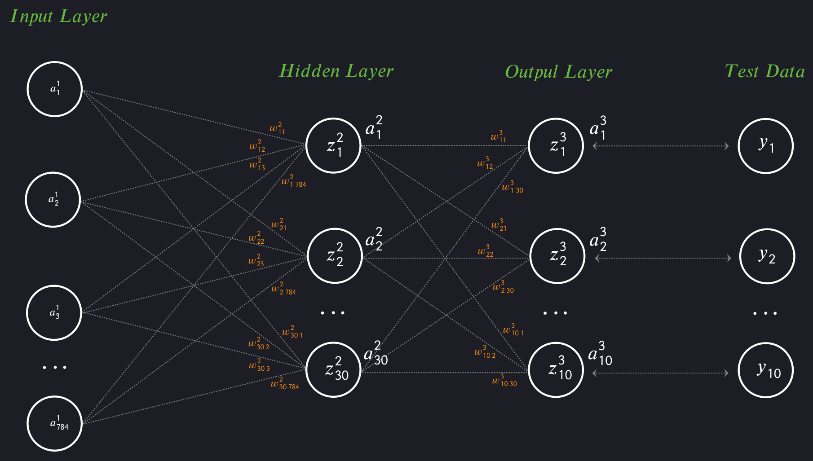

# NeuralNet
Studying the NN creation process: basic tasks solving and my own ideas realization.

**Goals:**

A. Complete chapter one of Nielsen book http://neuralnetworksanddeeplearning.com:
1. Describe mathematically the NeuralNet architecture on the iDroo board;
2. Compare notations between Nielsen's first chapter and architecture on IDROO, repeated by me;
3. Study the code from Nielsen's first chapter;
4. Afterward create code from scratch.

Let us assume that the structure of our neural network is represented as Python list as follows: 

nn_structure = [784, 30, 10] 

We also have training data formatted like: 

training_data = [ ( X_1, Y_1 ), ( X_2, Y_2 ), ... , ( X_50000, Y_50000 ) ]

To begin with let us algebraically describe input, hidden and output layers.

When we pass from the input layer to the hidden layer, we need to multiply each input value by the appropriate weight, as shown in the picture above. Let z_i^2 denote the resulting weighted sums for the second layer. Thus, we obtain the following system of equations:

$$
\begin{cases}
z_1^2 = w_{11}^2 a_1^1 + w_{12}^2 a_2^1 + \dots + w_{1\,784}^2 a_{784}^1 \\
z_2^2 = w_{21}^2 a_1^1 + w_{22}^2 a_2^1 + \dots + w_{2\,784}^2 a_{784}^1 \\
\dots \\
z_{30}^2 = w_{30\,1}^2 a_1^1 + w_{30\,2}^2 a_2^1 + \dots + w_{30\,784}^2 a_{784}^1
\end{cases}
$$

<small>System 1</small>
  

Now, these weighted sums must serve as the input data for the next, third layer. However, they cannot simply be fed into the next layer, as they can become extremely large. To prevent this, we pass each weighted sum through the sigmoid function to map all \(z_{i}^{2}\) values into numbers between 0 and 1. We can then rewrite the system of equations as follows (denote each results by a_i^2):

$$
\begin{cases}
a_1^2 = \sigma(z_1^2) \\
a_2^2 = \sigma(z_2^2) \\
\dots \\
a_{30}^2 = \sigma(z_{30}^2)
\end{cases}
$$

<small>System 2</small>
  

Now, each \(a_{i}^{2}\) serves as the input data for the next, third layer. Following this logic, we multiply each resulting value \(a_{i}^{2}\) by the corresponding weight between the second and third layers to obtain an analogous system of equations:

$$
\begin{cases}
z_1^3 = w_{11}^3 a_1^2 + w_{12}^3 a_2^2 + \dots + w_{1\,30}^3 a_{30}^2 \\
z_2^3 = w_{21}^3 a_1^2 + w_{22}^3 a_2^2 + \dots + w_{2\,30}^3 a_{30}^2 \\
\dots \\
z_{10}^3 = w_{10\,1}^3 a_1^2 + w_{10\,2}^3 a_2^2 + \dots + w_{10\,30}^3 a_{30}^2
\end{cases}
$$

<small>System 3</small>
  

and

$$
\begin{cases}
a_1^3 = \sigma(z_1^3) \\
a_2^3 = \sigma(z_2^3) \\
\dots \\
a_{10}^3 = \sigma(z_{10}^3)
\end{cases}
$$

<small>System 4</small>
  

Our goal is to implement the gradient descent process to find the correct weights and biases according to the following formulas:

$$
\begin{cases}
w_{\text{new}} = w_{\text{old}} - \eta \cdot \nabla C(w) \\
b_{\text{new}} = b_{\text{old}} - \eta \cdot \nabla C(b)
\end{cases}
$$

<small>System 5</small>
  

Naturally, each variable such as $w$, $b$ or $\nabla C$ is a vector of values. So, let's derive them. During the neural network training, an error $C_{m}$ is generated at each of its outputs $a_{m}$. We need to find the MSE (Mean Squared Error) for all such errors. To do this, we take the derivatives as follows:

$$
MSE = C(a_m) = \sum_{m=1}^{10} C_m = 0.5 \sum_{m=1}^{10} (a_m^3 - y_m)^2
$$

<small>Equation 1</small>
  

In system No. 5, the nabla operator represents the gradient—the vector of partial derivatives of our MSE. Thus:

$$
\nabla C(a_m) = \sum_{m=1}^{10} \frac{dC}{da_m^3} = \sum_{m=1}^{10} (a_m^3)' (a_m^3 - y_m)
$$ 

<small>Equation 2</small>
  

However, our goal is not to find how the gradient depends on the output layer activations $a_{m}$. Our task is to determine the dependence of $\nabla C$ on the weights and biases of the hidden (second) and final (third) layers:

$$
\begin{cases}
\nabla C(w_l) = ? \\
\\
\nabla C(b_l) = ?
\end{cases}, where \text{ } l \text{ } is \text{ } the \text{ } index \text{ } of \text{ } corresponding \text{ } layers
$$

<small>System 6</small>
  

Let us rewrite the equation 2 as follows:

$$
\nabla C(z_m^3) = \sum_{m=1}^{10} \frac{dC}{dz_m^3} = \sum_{m=1}^{10} \sigma'(z_m^3) (\sigma(z_m^3) - y_m)
$$

<small>Equation 3</small>
  

Le us $$ z^3 $$ transform to vector like $$ {z^3_1, z^3_2, … ,z^3_{10}} $$, and $$y$$ transform to a vector like $$ {y_1, y_2, …, y_{10}} $$, The equation 3 becomes as follows ∶

$$
\nabla C(z^3) = (\sigma(z^3) - y) \dot \sigma'(z^3)
$$

<small>Equation 4</small>
  

In Michael Nielsen's book, equation 4 is known as BP1. This formula demonstrates how the weighted sum of weights and biases between the second and third layers affects the final error.

We have come very close. Let us state the key questions: how do the weights and biases between the first and second layers, as well as between the second and third layers, affect the final error? To answer this, let us first clarify exactly how we will use these weights and biases in Python. In the Network() class, Michael Nielsen suggests storing the weights self.w and biases self.b as large matrices nested within lists, as follows:

$$
\text{self.w} = \left[\text{ }
\begin{pmatrix}
w_{11}^2 & w_{12}^2 & w_{13}^2 & w_{14}^2 & \dots & w_{1\,784}^2 \\
w_{21}^2 & w_{22}^2 & w_{23}^2 & w_{24}^2 & \dots & w_{2\,784}^2 \\
w_{31}^2 & w_{32}^2 & w_{33}^2 & w_{34}^2 & \dots & w_{3\,784}^2 \\
\dots & \dots & \dots & \dots & \ddots & \dots \\
w_{30\,1}^2 & w_{30\,2}^2 & w_{30\,3}^2 & w_{30\,4}^2 & \dots & w_{30\,784}^2
\end{pmatrix}
,\text{ }
\begin{pmatrix}
w_{11}^3 & w_{12}^3 & w_{13}^3 & \dots & w_{1\,30}^3 \\
w_{21}^3 & w_{22}^3 & w_{23}^3 & \dots & w_{2\,30}^3 \\
\dots & \dots & \dots & \ddots & \dots \\
w_{10\,1}^3 & w_{10\,2}^3 & w_{10\,3}^3 & \dots & w_{10\,30}^3
\end{pmatrix}
\text{ }\right]
$$

<small>Equation 5</small>
  

$$
\begin{gathered}
\text{self.b} = \left[\text{ }
\begin{pmatrix}
b_1^2 \\
b_2^2 \\
b_3^2 \\
\dots \\
b_{30}^2
\end{pmatrix}
,\text{ }
\begin{pmatrix}
b_1^3 \\
b_2^3 \\
\dots \\
b_{10}^3
\end{pmatrix}
\text{ }\right]
\end{gathered}
$$

<small>Equation 6</small>
  

