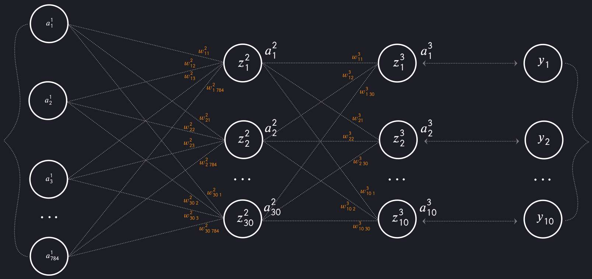

# NeuralNet
Studying the NN creation process: basic tasks solving and my own ideas realization.

**Goals:**

A. Complete chapter one of Nielsen book http://neuralnetworksanddeeplearning.com:
1. Describe mathematically the NeuralNet architecture on the iDroo board;
2. Compare notations between Nielsen's first chapter and architecture on IDROO, repeated by me;
3. Study the code from Nielsen's first chapter;
4. Afterward create code from scratch.

Let us assume that the structure of our neural network is represented as Python list as follows: 

nn_structure = [784, 30, 10] 

We also have training data formatted like: 

training_data = [ ( X_1, Y_1 ), ( X_2, Y_2 ), ... , ( X_50000, Y_50000 ) ]

To begin with let us algebraically describe input, hidden and output layers.
